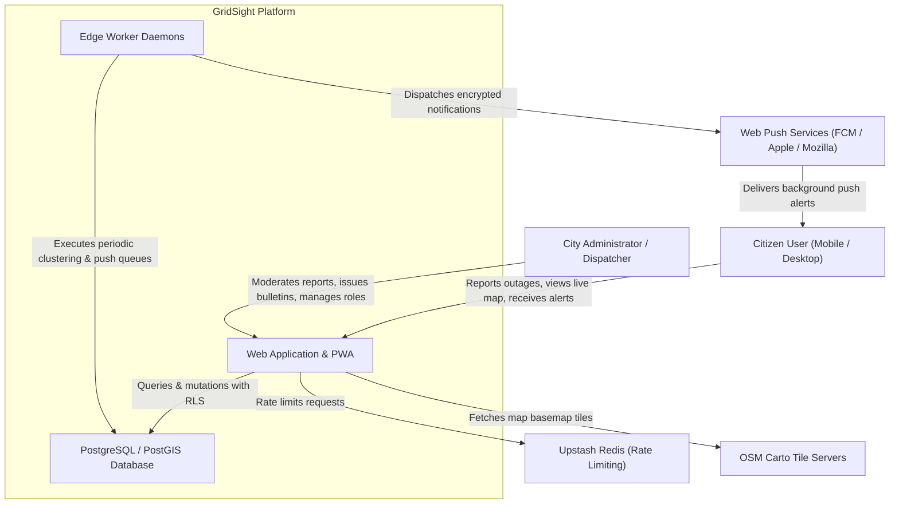
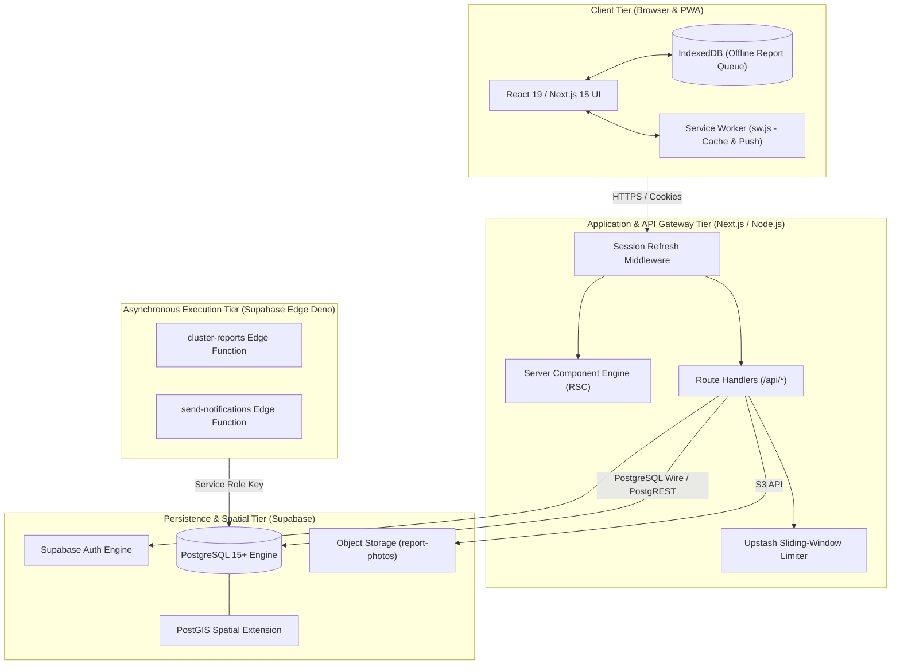
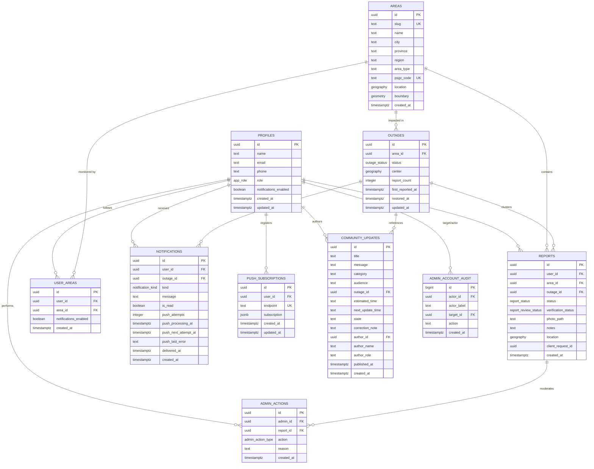
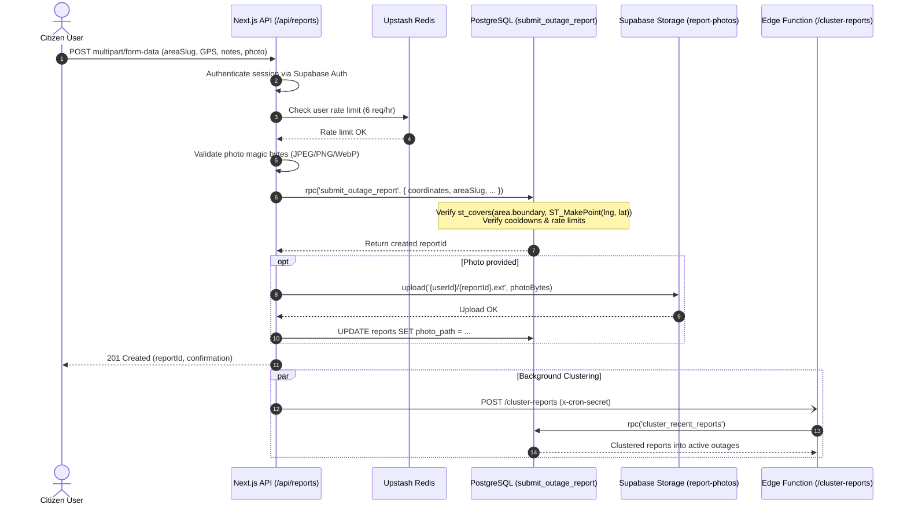
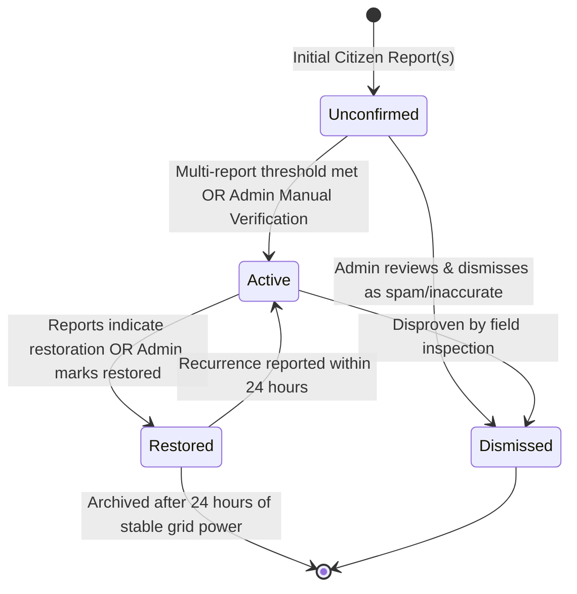
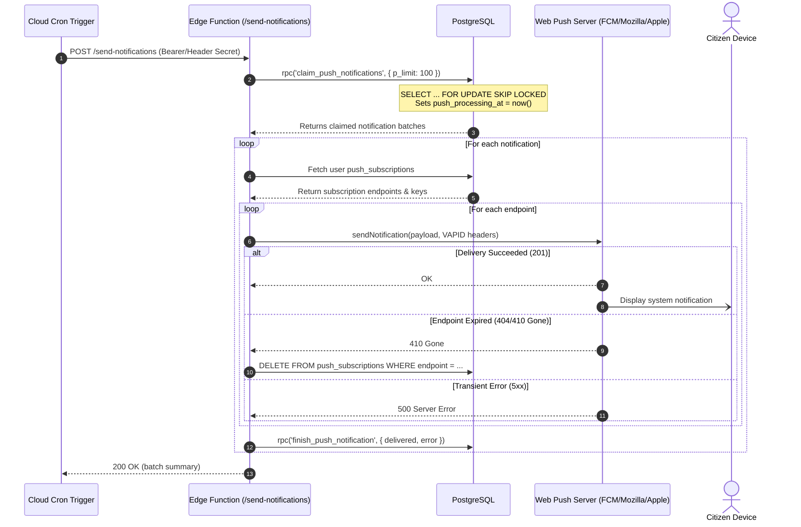
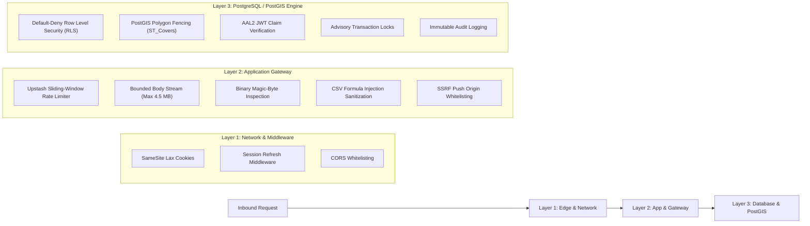

# GridSight — System Architecture & Design Documentation

> **Status:** Production-Ready (Surigao City Pilot)  
> **Version:** 1.0.0  
> **Target Geography:** City of Surigao, Surigao del Norte, Philippines (54 Barangays)  
> **Related Documents:** [API.md](API.md) | [README.md](README.md) | [USER_MANUAL.md](USER_MANUAL.md)

---

## 1. Executive Summary & System Mission

GridSight is a resilient, civic-grade power outage reporting, spatial analytics, and emergency communication platform engineered for the **City of Surigao, Philippines**. It bridges the information gap between residents experiencing localized power interruptions and municipal disaster/utility coordinators.

### Core Objectives
1. **Verifiable Citizen Telemetry:** Enables residents to report outages with millimeter-accurate GPS coordinates or manual barangay selection.
2. **Spatial Boundary Containment:** Uses PostGIS polygon boundaries for all 54 Surigao City barangays to reject spoofed or mislocated reports.
3. **Automated Incident Clustering:** Continuously aggregates disparate reports within temporal and spatial sliding windows into cohesive outage events.
4. **Resilience & Offline-First Operation:** Functions during severe cellular degradation or complete connectivity loss via IndexedDB client queues and Progressive Web App (PWA) service workers.
5. **Zero Trust Administrative Workspace:** Enforces strict Role-Based Access Control (RBAC), Authenticator Assurance Level 2 (AAL2) Multi-Factor Authentication (MFA), and immutable audit logs.
6. **Multi-Channel Dispatch:** Dispatches Web Push notifications and in-app alerts to citizens when power fails or is restored in their subscribed barangays.

---

## 2. High-Level System Architecture (C4 Model)

### 2.1 System Context Diagram (C4 Level 1)

### 2.2 Container Diagram (C4 Level 2)

---

## 3. Subsystem Breakdown & Component Architecture

### 3.1 Frontend & Progressive Web App (PWA)
* **Framework:** Next.js 15 (App Router) with React 19 and Tailwind CSS.
* **Dual Ergonomic Strategy:**
  * **Desktop ($\ge 768px$):** Wide-viewport executive dashboard with comprehensive tabular views, sticky header, and full analytical breakdown.
  * **Mobile ($< 768px$):** Bottom-anchored navigation (`MobileBottomNav`), sticky compact top bar (`MobileHeader`), dedicated 1-tap report button (`MobileReportFab`), and 44px+ touch targets conforming to Apple Human Interface & Android Material guidelines.
* **Service Worker (`public/sw.js`):**
  * *App Shell Cache:* Pre-caches core routes for instant cold start during network degradation.
  * *Runtime Cache:* Cache-first strategy for static assets (fonts, icons, styles).
  * *Push Handler:* Listens to system push events, surfaces native notifications, and opens target URLs on interaction.
* **Offline Queue (`src/lib/offline-queue.ts`):**
  * Persists failed or offline submissions directly into client IndexedDB (`gridsight-offline`).
  * Stores full multipart metadata including raw image `Blob` objects.
  * Re-synchronizes automatically on browser `online` window events with exponential backoff and idempotency client UUIDs.

### 3.2 Application & API Gateway Tier
* **Stateless Route Handlers:** Implemented in `src/app/api/` with strict Node.js runtime enforcement.
* **Zero Trust Payload Validation:** All inputs parsed using strict Zod schemas with regex guards against path traversal, script injection, and invalid coordinates.
* **DoS & Memory Exhaustion Defenses:**
  * Strict bounded body streams (`readBoundedBody`) capped at 4.5 MB.
  * Image uploads inspected at binary level (magic-byte headers) to ensure JPEG (`FF D8 FF`), PNG (`89 50 4E 47`), or WebP (`RIFF...WEBP`) validation prior to disk/bucket writing.
* **Distributed Rate Limiting:** Backed by Upstash Redis:
  * Public reporting: 6 submissions per hour per user.
  * Administrative mutations: 5 operations per minute per admin.

### 3.3 Persistence & Spatial Tier (PostgreSQL + PostGIS)
* **PostGIS Core Extensions:**
  * Spatial indexes (`GIST`) applied to area boundaries and incident centroids.
  * Polygon containment functions (`extensions.st_covers`) ensure reported coordinates reside strictly inside the chosen barangay polygon boundary.
* **Row-Level Security (RLS):**
  * Every table operates under default-deny RLS.
  * Fine-grained policies distinguish between anonymous guests, signed-in citizens, and verified administrators.
* **Atomic Stored Procedures:**
  * `submit_outage_report`: Enforces spatial bounds, hourly rate limits, per-barangay cooldowns, and creates reports within an ACID transaction.
  * `moderate_report`: Verifies or dismisses observations and recalculates incident clustering metrics.
  * `admin_set_account_role`: Manages administrator promotions and demotions under PostgreSQL advisory transaction locks (`pg_advisory_xact_lock(77123, 1)`), preventing orphan admin lockouts.

---

## 4. Data Architecture & Entity Relationships

### 4.1 Entity-Relationship Diagram (ERD)

---

## 5. Core Data Flows & Sequences

### 5.1 Outage Report Ingestion & Spatial Verification

### 5.2 Outage Incident Lifecycle State Machine

### 5.3 Web Push Dispatch Queue Flow

---

## 6. Security Architecture & Threat Model

### 6.1 Authentication Hierarchy & Role-Based Access Control (RBAC)

The platform distinguishes 4 distinct security tiers:

| Security Tier | Identity Verification | Capabilities |
| :--- | :--- | :--- |
| **Anonymous (Guest)** | None | Access landing page, read cached community bulletins, view login/register. |
| **Authenticated Citizen** | Supabase Auth (Session Cookie) | View live interactive map (`/api/outages`), submit reports, view personal report history, manage area notification preferences. |
| **Admin (Tier 1 - Standard)** | Auth + Email Confirmed + Role `admin` | View administrator desk read-only metrics and queues. |
| **Admin (Tier 2 - AAL2 MFA)** | Auth + Email Confirmed + Role `admin` + TOTP | Execute report verification/dismissal, issue/withdraw community bulletins, override outage status, invite/promote/demote staff. |

### 6.2 Defense-in-Depth Measures

#### Key Mitigations:
1. **SSRF & Push Poisoning:** Web push endpoint URLs are strictly validated against a known whitelist (`fcm.googleapis.com`, `updates.push.services.mozilla.com`, `web.push.apple.com`, `notify.windows.com`) with prohibited ports, usernames, and passwords.
2. **Formula Injection (DDE) in CSV Exports:** The CSV export stream inspects every cell string. Any cell starting with `=, +, -, @` is automatically escaped with an apostrophe (`'`), preventing formula execution in Microsoft Excel and LibreOffice Calc.
3. **GPS Boundary Spoofing:** When coordinates are passed, the database invokes `extensions.st_covers(area.boundary, ST_MakePoint(lng, lat))`. If the GPS pin is outside the declared barangay polygon, the submission is rejected with an explanatory message.
4. **Race Conditions in Admin Operations:** Modifying administrative privileges uses PostgreSQL advisory locks (`pg_advisory_xact_lock(77123, 1)`). This guarantees that concurrent demotions cannot accidentally eliminate the last standing administrator.

---

## 7. Storage & Asset Management

### 7.1 Report Photos Bucket (`report-photos`)
* **Access Mode:** Private (Non-public).
* **Storage Path Hierarchy:** `{user_id}/{report_id}.{ext}`
* **Storage Policies:**
  * `INSERT`: Permitted only for authenticated users where the root path matches `auth.uid()`.
  * `SELECT`: Permitted for the photo owner OR any user possessing the verified `admin` role.
  * `DELETE`: Permitted for the photo owner OR verified administrators.
* **Upload Limits:** Hard capped at 4,194,304 bytes (4 MB) and restricted to `image/jpeg`, `image/png`, and `image/webp`.

---

## 8. Deployment, Infrastructure & Environment

### 8.1 Deployment Topologies
* **Vercel / Next.js Serverless:** Hosts SSR components, client assets, and Next.js Node.js Route Handlers.
* **Supabase Managed Cloud / Self-Hosted:** Houses PostgreSQL 15, PostGIS extension, Auth Engine, Storage Buckets, and Realtime server.
* **Upstash Redis:** Serverless low-latency Redis cluster providing distributed sliding-window rate limit counters.
* **Supabase Edge (Deno):** Runs lightweight background worker jobs triggered via cron.

### 8.2 Environment Variable Matrix

| Variable | Scope | Description |
| :--- | :--- | :--- |
| `NEXT_PUBLIC_SUPABASE_URL` | Client & Server | Base URL of the Supabase instance. |
| `NEXT_PUBLIC_SUPABASE_ANON_KEY` | Client & Server | Public anonymous API key (governed by RLS). |
| `SUPABASE_SERVICE_ROLE_KEY` | Server Only | High-privilege key used for admin bootstrapping and Edge Function workers. |
| `UPSTASH_REDIS_REST_URL` | Server Only | REST endpoint for Upstash Redis cluster. |
| `UPSTASH_REDIS_REST_TOKEN` | Server Only | Authentication token for Upstash Redis cluster. |
| `CLUSTER_CRON_SECRET` | Server & Edge | Shared authorization secret for triggering `/cluster-reports`. |
| `PUSH_CRON_SECRET` | Server & Edge | Shared authorization secret for triggering `/send-notifications`. |
| `VAPID_PUBLIC_KEY` | Client & Server | NIST P-256 public key for Web Push protocol. |
| `VAPID_PRIVATE_KEY` | Server & Edge | Private key for signing Web Push JWT headers. |
| `VAPID_SUBJECT` | Server & Edge | Mailto contact URI (`mailto:admin@gridsight.ph`) for push identification. |
| `NEXT_PUBLIC_APP_URL` | Server Only | Base canonical URL used for generating auth invite redirects. |

---

## 9. Monitoring, Observability & Disaster Recovery

1. **Transaction Logging & Audit Trail:**
   * All administrative actions (invitations, role escalation, role demotion, moderation verifications, report dismissals, and bulletin withdrawals) generate persistent rows in `admin_account_audit`, `admin_actions`, or `community_updates.correction_note`.
2. **Dead-Letter Handling in Web Push:**
   * If a notification fails delivery, `push_attempts` is incremented with exponential backoff (`push_next_attempt_at`). After 5 consecutive failures, the item is quarantined to protect Edge worker throughput.
3. **Realtime Subscriptions:**
   * `public.outages` is configured for PostgreSQL replication to broadcast real-time status shifts directly to the interactive Leaflet map without client polling.
4. **Disaster Backups:**
   * Automated daily PostgreSQL logical dumps via Supabase point-in-time recovery (PITR).
   * Spatial barangay boundaries and seed centroids are versioned in git under `supabase/migrations/0002_surigaocity_barangays.sql` through `0017`.
